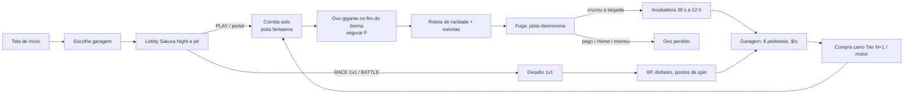

# Loop do jogo

## Loop atual (Beta 1.3 a 1.9)

1. Tela de início (START / CONFIGS / CREDITS / UPDATES / 🌐 Languages).
2. Escolhe a garagem (◀ ▶) e nasce a pé no lobby.
3. PLAY no dock (ou entra no portal), vai ao grid, 3-2-1-GO.
4. Dirige até o **ovo gigante** no fim do bioma, segura **F**, e a **roleta** mostra o personagem sorteado no servidor.
5. A pista **desmorona** atrás do carro. Cruzar a largada põe o ovo na **incubadora**.
6. O ovo choca (30 s a 12 h, conforme a raridade) e o personagem vai para um pedestal da **garagem**, onde rende $/s.
7. O dinheiro compra carro de tier maior, que abre o próximo bioma.
8. Em paralelo: **Roleta da sorte** (8 h, giros extras e pontos de spin) e **desafio 1v1** (corrida de F1 ou batalha).

## Como o loop evoluiu

| Versão | Loop |
|--------|------|
| 0.1.0 | dirigir → **capturar** em mini-jogo de timing → fazenda → renda |
| 0.2.0 | a fazenda vira **garagem** de 8 pedestais; 7 biomas |
| 1.1 | captura guardada; **ovos** de estrada e santuários; tela de início; jogador a pé |
| 1.2 | lobby separado; **corrida solo** por slot (pista fantasma) |
| 1.3 | **ovo gigante, roleta, fuga e incubadora** (o loop atual) |
| 1.6b → 1.7 | ovo pego passando com o carro, depois volta o "segurar F" |
| 1.9 | estrelas, nível e XP; **desafio 1v1**; pontos de spin |

Relacionado: [Visão e pilares](Visao_e_Pilares.md) · [Ovo, roleta e fuga](../02_Sistemas/Ovo_Gigante_Roleta_Fuga.md) · [Corrida solo](../02_Sistemas/Corrida_Solo_Pista_Fantasma.md) · [Desafio 1v1](../02_Sistemas/Desafio_1v1.md) · [Linha do tempo](../07_Versoes/INDEX.md)
