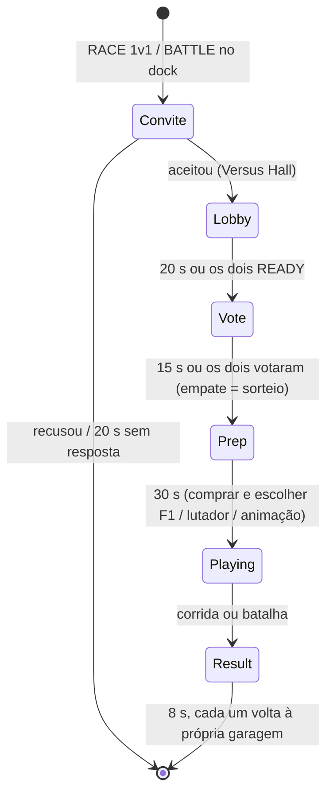

# Desafio 1v1

## Fluxo (igual para corrida e batalha)

- Sair antes do jogo cancela sem recompensa. Sair durante o jogo dá a vitória ao outro; quem saiu não recebe nada.

## Servidor (`Services.VersusService`)
- Convites, etapas, votação, recompensas, lojas (`GetVersusShop`, `BuyF1`/`EquipF1`, `BuyVictoryFx`/`EquipVictoryFx`),
  `Teleport`, atributos `F1Equipped`/`FxEquipped`, `match.Forfeit`.
- **Padrão `RegisterMode`:** o VersusService não conhece corrida nem batalha. Cada modo registra
  `Maps`, `CanJoin`, `Start`, `Abort`, `XpTarget` e chama `VersusService.Finish(match, winner, info)`.
  Um terceiro modo no futuro (2v2, drift) é só outro `RegisterMode`.
- Modos: "Race" → [Corrida 1v1 de F1](Corrida_1v1_F1.md) · "Battle" → [Batalha de anime](Batalha_de_Anime.md).

## Cliente (`Client.VersusUI`)
Painel "Challenge a Player" (lista livre/ocupado), cartão de convite (teclas Y/N), faixa Lobby/Vote/Prep,
tela de resultado, lojas, escolha do lutador, ProximityPrompt "VersusShop" nos balcões do Hall.
O dock ganhou os botões **RACE 1v1** e **BATTLE** à esquerda (`DOCK_W 920`); o dock some com `MatchId ≠ 0`.

## Atributos e rede
`MatchId`, `VersusMode`, `VersusStage`. Ações: `VersusPlayers`, `VersusInvite`, `VersusRespond`, `VersusCancel`,
`VersusReady`, `VersusVote`, `VersusLeave`. Eventos: `VersusInvited`, `VersusInviteClosed`, `VersusState`, `VersusResult`.

## Mapa
Versus Hall em (1400, 0, 3200) com as lojas; arenas em x = -1400. → [Versus Hall e arenas](../03_Conteudo/Versus_Hall_e_Arenas.md)

## Testado / não testado
- ✅ painel, validações (convidar a si mesmo, modo inválido, sem dinheiro, item inválido, `NotOwned`).
- ❌ **tudo que precisa de 2 jogadores** (convite real, Hall, votação, partida, recompensas, sair no meio).

Relacionado: [Recompensas e pontos de spin](Recompensas_e_Pontos_de_Spin.md) · [Música e sons](Musica_e_Sons.md) · [Não testado](../13_Pendencias/Nao_Testado.md) · [Beta 1.9](../07_Versoes/Beta_1.9.md)
