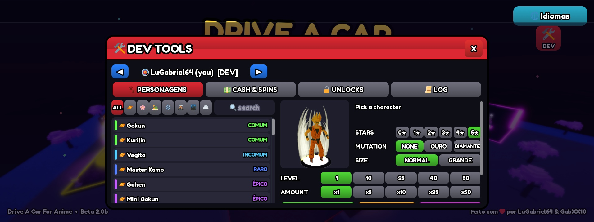
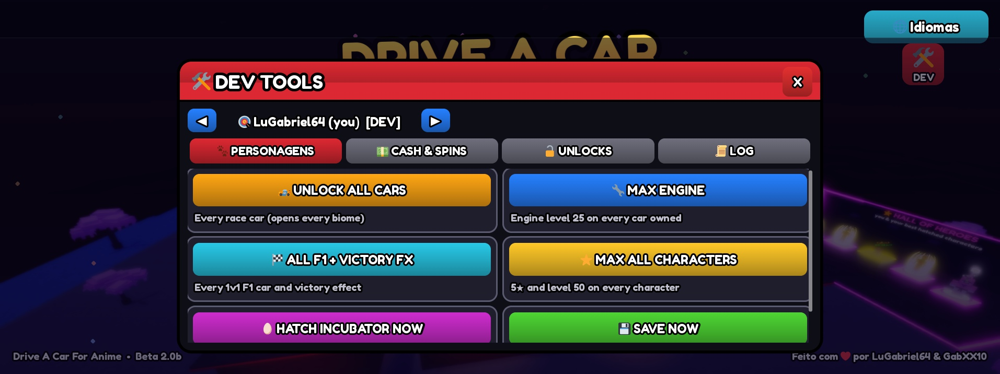
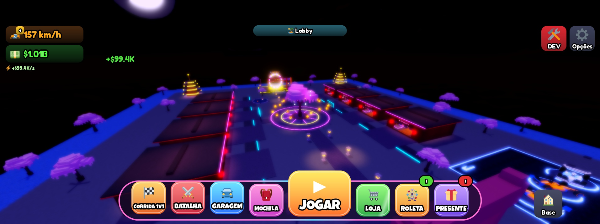

# Painel DEV (Beta 2.0b)

Painel só dos desenvolvedores para testar sem correr: dar personagens (com estrelas, mutação, nível), dinheiro, giros,
carros e itens do 1v1, a si mesmo ou a qualquer jogador do servidor.

## Quem é DEV

| Onde | O quê |
|------|-------|
| `Config.Dev.Members` | lista por **UserId** (o nome pode mudar): LuGabriel64 = 158350958, GabXX10 = 338868517 |
| `Config.Dev.GroupMinRank` | 0 = desligado. Se > 0, quem tem esse rank no grupo "Resenha's House" também vira DEV (hoje os dois são "Admin", rank 254; não existe cargo "DEV" no grupo) |
| `Config.Dev.StudioTestPlayers` | no Studio, os bonecos Player1/Player2 (UserId ≤ 0) também são DEV, para o teste de 2 jogadores |
| `Config.Dev.Enabled` | false = some o painel e as ações `Dev*` deixam de existir |

**Segurança:** o servidor (`Services.DevService`) confere o UserId em **toda** ação. O atributo `IsDev` do Player serve
só para o cliente desenhar o botão e a etiqueta do chat. Um jogador comum não recebe o painel; se chamar a ação na mão,
recebe `NotDev` e a tentativa fica no Output.

## O painel (`Client.DevPanel`)

Abre pelo botão vermelho **🛠️ DEV** ao lado do ⚙️ (aparece também na tela de início) ou pela tecla **F7**.

| Aba | O que faz | Ação no servidor |
|-----|-----------|------------------|
| Alvo (topo) | ◀ ▶ escolhe quem recebe; mostra dinheiro, renda, giros e pontos do alvo | `DevInfo` |
| CHARACTERS | lista com filtro por bioma, busca e prévia 3D; 0–5★, Gold/Diamond, BIG, nível 1–50, x1–x50 | `DevGiveAnime` (GIVE; HATCH = incubadora, choca em 2 s), `DevGiveAll` |
| CASH & SPINS | somar ou definir dinheiro (2.5M, 1B, 1T, 1QA), +1K…+1QA, giros ±, pontos, giro grátis já | `DevCash`, `DevSpins` |
| UNLOCKS | todos os carros, motor 25, todos os F1 e efeitos de vitória, personagens 5★ Lv50, chocar agora, salvar agora | `DevCars`, `DevVersusShop`, `DevMaxAnimes`, `DevHatchNow`, `DevSaveNow` |
| LOG | quem fez o quê neste servidor (últimas 60 ações) | `DevInfo` |

Extra: etiqueta vermelha **[DEV]** antes do nome no chat (`TextChatService.OnIncomingMessage`, todos os clientes).

## Detalhes que importam

- "Unlock all cars" não troca o carro: para ir a um bioma mais alto, equipe o carro na garagem.
- A loja do F1 só mostra os itens novos quando é reaberta.
- No Studio sem "Enable Studio Access to API Services", "Save now" responde ok mas nada é gravado (dados temporários).
- Os textos do painel ficam em inglês e sem tradução: não é UI de jogador. Alguns rótulos saem em português porque o
  `Locale` já tinha a palavra (ex.: "PERSONAGENS", "OURO").
- Estrelas vão até 5 (`Config.Stars.Max`), o máximo do jogo.

## Testar pelo MCP

Os cliques do MCP não chegam na interface. Chame as ações pelo `Shared.Net` no datamodel **Client**:
`Net.Call("DevGiveAnime", nil, "super_goku", { Stars = 5, Mut = "Gold", Level = 50, Count = 1 })` (o 1º argumento é o
UserId do alvo; `nil` = você).

Relacionado: [Rede (Net)](Rede_Net.md) · [Save](Save_DataService.md) · [Estrelas, nível e XP](Estrelas_Nivel_XP.md) · [Roleta da sorte](Roleta_da_Sorte.md) · [Beta 2.0b](../07_Versoes/Beta_2.0b.md)

Up: [Sistemas](INDEX.md)
