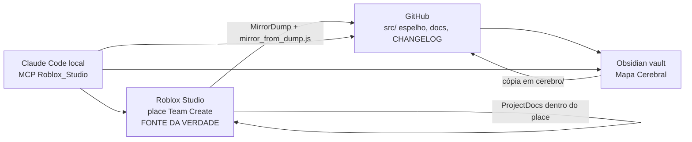

# Arquitetura

## Três lugares, três papéis

- **Studio** = o jogo. Edição via MCP (`execute_luau`, `multi_edit`) pelo Claude Code local.
- **GitHub** `LuGabriel64/DriveACarForAnime` = espelho versionado (`src/` em formato Rojo, sem Rojo sincronizando),
  histórico (`CHANGELOG.md`), `estado-atual/`, `planejamento/`, `places/*.rbxl`.
- **ProjectDocs** dentro do place = documentação oficial (00 Bíblia, 01 ChangeLog, 02 Protocolo, 03 Guia, 04 Estado).
- **Este vault** = mapa cerebral (ideias, requisitos, decisões, estratégias), copiado para `cerebro/` no repositório.

## Camadas do jogo
| Camada | Onde | Papel |
|--------|------|-------|
| Shared | `ReplicatedStorage.Shared` | Config (números), Net, Util, fábricas, AnimeStats, Locale |
| Server | `ServerScriptService.Main` + `Services` | decide tudo; cada serviço tem `Init()` que registra `Net.Handle` |
| Client | `StarterPlayerScripts.ClientMain` + `Client` | UI e visual; cada módulo tem `Init()` |
| Tools | `ServerStorage.Tools` | geração do mapa (edição) e espelho |

`Main.ORDER`: Data, Farm, Car, Zone, Race, Egg, Incubator, Escape, Wheel, Progress, Versus, DuelRace, Battle,
Anime, Gift (cada um em `pcall`). Bibliotecas sem Init: EggRoll, BattleSim.

## Princípios
1. Servidor decide; cliente encena (fuga, colapso, obstáculos e batalha são visuais no cliente, regra no servidor).
2. Uma pista para todos (pista fantasma) em vez de cópias.
3. Relógio do servidor (`os.time`, `GetServerTimeNow`) para tudo que é tempo.
4. Modos plugáveis (`VersusService.RegisterMode`).
5. Determinismo: mapa por semente, batalha por semente.

Relacionado: [Mapa de scripts](Mapa_de_Scripts.md) · [Convenções](Convencoes.md) · [Rede (Net)](../02_Sistemas/Rede_Net.md) · [Ferramentas](../14_Equipe_e_Ferramentas/Ferramentas_MCP_GitHub.md)
