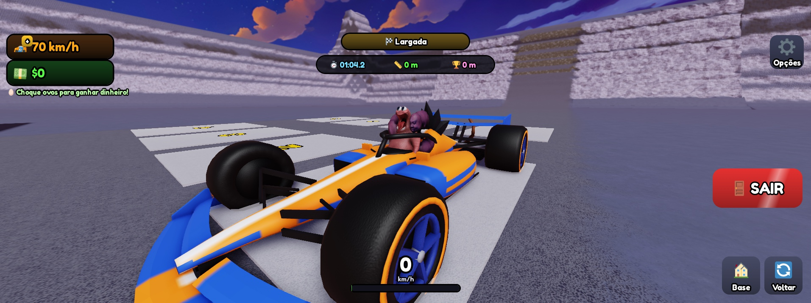
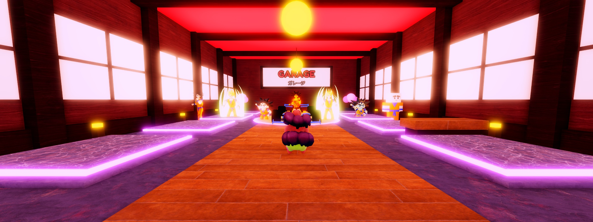

# Beta 2.0 (em andamento desde 15/11/2026)

**Pedido do dono:** carros de Fórmula 1 modelados no Blender, 3 por bioma, com pintura do bioma e acessórios
(bioma 1 com tema e um Mini Goku voando junto); personagem Mini Goku Épico com 2 skins; elenco do bioma 1
remodelado pelas imagens + novo Secret e novo Mítico; primeira pessoa na corrida; modo Manual/Automático com
piloto automático, skill-checks e falhas; combustível; teto no engine upgrade e novo Fuel Engine.

Projeto completo: `planejamento/beta-2.0/README.md` no repositório.

| Etapa | Conteúdo | Estado |
|-------|----------|--------|
| A | arte dos 21 carros no Blender (FBX + pinturas) | ✅ versão 1, **aprovada pelo dono em 16/11** |
| B | importar no Roblox, `CarFactory` com malhas, companheiro voador | 🟡 **importação feita (22/11)**: 21 carros e 4 personagens em `ReplicatedStorage.Assets`; falta o `CarFactory` usar as malhas e o companheiro voador |
| C | 21 carros no Config, combustível, upgrades, primeira pessoa, Manual/Auto, piloto automático, skill-checks | ⏳ projetado |
| D | personagens do bioma 1 em malha + 3 novos | ⏳ arte **v3** de Gokun, Super Gokun e Mini Gokun (2 skins), versão de jogo e animação de parado feitas; motor `Shared.CharacterRig` no place; faltam os outros personagens e a importação |
| E | fechamento, testes, tag | ⏳ |

**Feito em 15/11:** gerador paramétrico (`arte/blender/`), 21 carros exportados, folha de renders, estudo do
Mini Gokun em 2 skins, 20 imagens de referência guardadas com nota.

**Feito em 16/11:** personagens v2 por [escultura SDF](../05_Modelagem/Personagens_SDF_Blender.md) (o dono pediu estilo anime 2.5D com cel-shading): Gokun, Super Gokun com aura, Mini Gokun nas 2 skins sobre a nuvem com fumaça. Resultado e as 9 referências em [Referências 16/11](../11_Referencias_Visuais/2026-11-16_Gokun_Referencias_v2.md). A v1 ficou guardada. O upload para o Roblox foi recusado (pasta não aprovada).

**Feito em 16/11 (segundo pedido):** estilo aprovado com ajustes. [v3](../11_Referencias_Visuais/2026-11-16_Gokun_Cabeca_v3.md): rosto fino de anime, pescoço, franja, mãos com dedos, cotovelo e joelho articulados; versão de jogo (24 a 27 mil triângulos); [animação de parado](../05_Modelagem/Animacao_Idle_CharacterRig.md) dos três (guarda de luta, carregando energia, mirim na nuvem). **No place:** backup `Backups["Beta 1.9"]`, `Shared.CharacterRig` e `Shared.CharacterAnims` (sem uso ainda), entrada no ChangeLog, salvo. Versões antigas em `arte/arquivo/`. O upload continua recusado.

**Feito em 22/11:** upload liberado; 25 assets enviados (grupo 879120012) e guardados normalizados em `ReplicatedStorage.Assets`; animação testada com as malhas → [sessão](../15_Registro_de_Sessoes/2026-11-22_Beta_2.0_Malhas_no_Roblox.md).

**APLICADA AO JOGO em 22/11 (place versão 132, não publicada):** todos os carros em malha, Gokun em malha, novos Super Gokun (Secret) e Mini Gokun (Epic), personagens animados (`Client.CharacterAnimator`). Testado no Play: corrida com o carro novo (69/70 km/h, rodas girando), garagem, vitrine, personagens animados. Não testado: ovo chocando os novos, ícones, batalha, 1v1 com 2 jogadores, celular. Lista completa no `CHANGELOG.md` do repositório. Próximas: 2.0b combustível, 2.0c piloto automático, 2.0d primeira pessoa + 21 carros.

**Testado:** geração e render (conferidos na imagem); vídeo das animações; a conta do `CharacterRig` no Studio contra o Blender (boneco de blocos, modo Edit). **Não testado:** malhas no Roblox, animação com as malhas reais, Play, celular.

**Por que parou aqui:** o Roblox Studio estava fechado e o MCP do Blender desligado. A arte foi feita com o
Blender em segundo plano; o código do jogo espera o Studio.

Relacionado: [Beta 1.9](Beta_1.9.md) · [Carros de F1 no Blender](../05_Modelagem/Carros_F1_Blender.md) · [Referência dos carros](../11_Referencias_Visuais/2026-11-15_Beta2_Carros_F1.md) · [Referência dos personagens](../11_Referencias_Visuais/2026-11-15_Beta2_Personagens_Bioma1.md) · [Tarefas do dono](../13_Pendencias/Tarefas_do_Dono.md)
