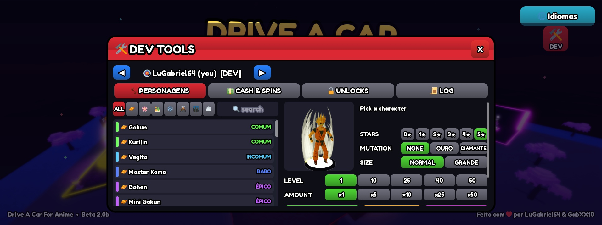

# Beta 2.0b (25/11/2026)

**Pedido do dono:** "uma aba só nossa (cargo DEV) para pegar personagens sem correr, com quantas estrelas quiser, dinheiro
e spins. Faça algo realmente para DEVS." E: "mude os créditos para LuGabriel64 e Gabxx10".

## O que entrou

- **Painel 🛠️ DEV** (botão vermelho ao lado do ⚙️, ou tecla F7), só para a equipe de `Config.Dev`. Como funciona:
  [Painel DEV](../02_Sistemas/Painel_DEV.md).
- **Créditos:** "Created by" e "Game Design & Build" = LuGabriel64 & GabXX10 (nome de usuário do Roblox, com os X maiúsculos).
- Novidade "Beta 2.0b" no menu (texto curto para o jogador).
- Save **não** mudou (Version 3).

## Scripts

| Script | O quê |
|--------|-------|
| `Services.DevService` (novo) | ações `Dev*`, confere o UserId em toda ação, registro `[DEV]` |
| `Client.DevPanel` (novo) | o painel e a etiqueta [DEV] do chat |
| `Shared.Config` | `Version = "Beta 2.0b"`, `Config.Credits`, `Config.Dev`, `Updates` |
| `Services.WheelService` | + `WheelService.Push(player)` |
| `ServerScriptService.Main` / `ClientMain` | + `DevService` / + `DevPanel` |

Backup: `ServerStorage.Backups["Beta 2.0"]`. Tag git: `beta-2.0b`.

## Testado / não testado

- **Testado (Play, 1 jogador):** todas as 10 ações pelo `Shared.Net` do cliente (dinheiro, giros, pontos, giro grátis,
  personagem 5★ Gold Lv50, HATCH, GIVE ALL, carros, motor, F1, max, chocar, salvar); alvo e personagem inválidos recusados;
  etiqueta [DEV] no chat; telas em captura; créditos no menu; Output sem erros.
- **Não testado:** clique real nos botões (o MCP não clica na UI), conta não-DEV, dar para outro jogador (2 jogadores),
  jogo publicado, celular.

## Próximas

A numeração andou: **2.0c** combustível + teto do motor + Fuel Engine; **2.0d** Manual/Auto + piloto automático +
skill-checks; **2.0e** primeira pessoa + 21 carros na loja. O dono também quer mexer no **design dos outros personagens**
antes de "uma nova missão".

Relacionado: [Beta 2.0](Beta_2.0.md) · [Painel DEV](../02_Sistemas/Painel_DEV.md) · [Sessão](../15_Registro_de_Sessoes/2026-11-25_Beta_2.0b_Painel_DEV.md)

Up: [Versões](INDEX.md)
