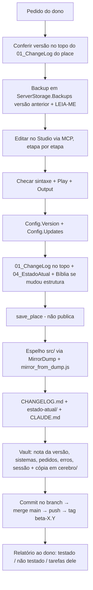

# Fluxo de versão

- Numeração: 1.8 → 1.8b → 1.8c… ; mudança grande sobe o número (1.9, 2.0). Se a versão planejada já existir no place, use a seguinte.
- O `.rbxl` em `places/` e a publicação são do dono.

Relacionado: [Checklist antes de mexer](../09_Erros_e_Licoes/Checklist_Antes_de_Mexer.md) · [Linha do tempo](../07_Versoes/INDEX.md) · [Manter o vault](Manter_o_Vault.md)
