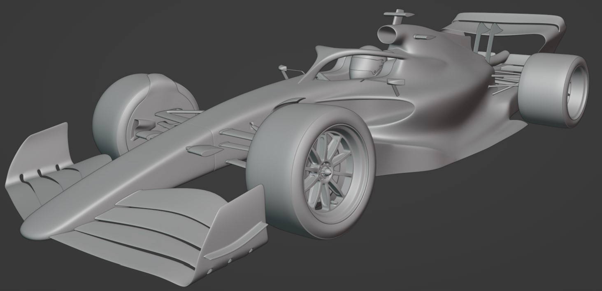
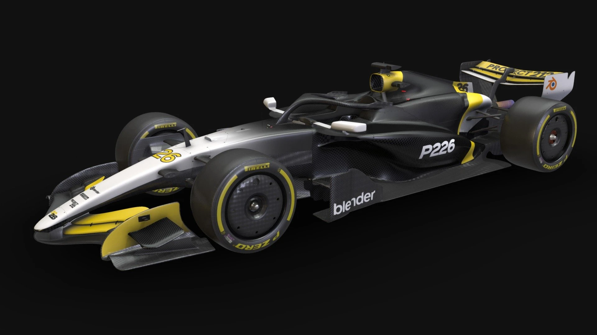
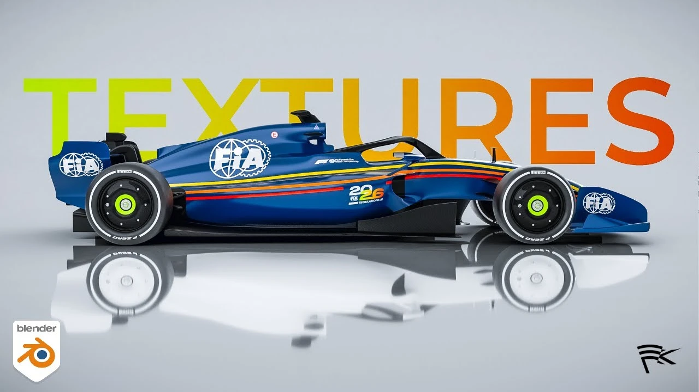
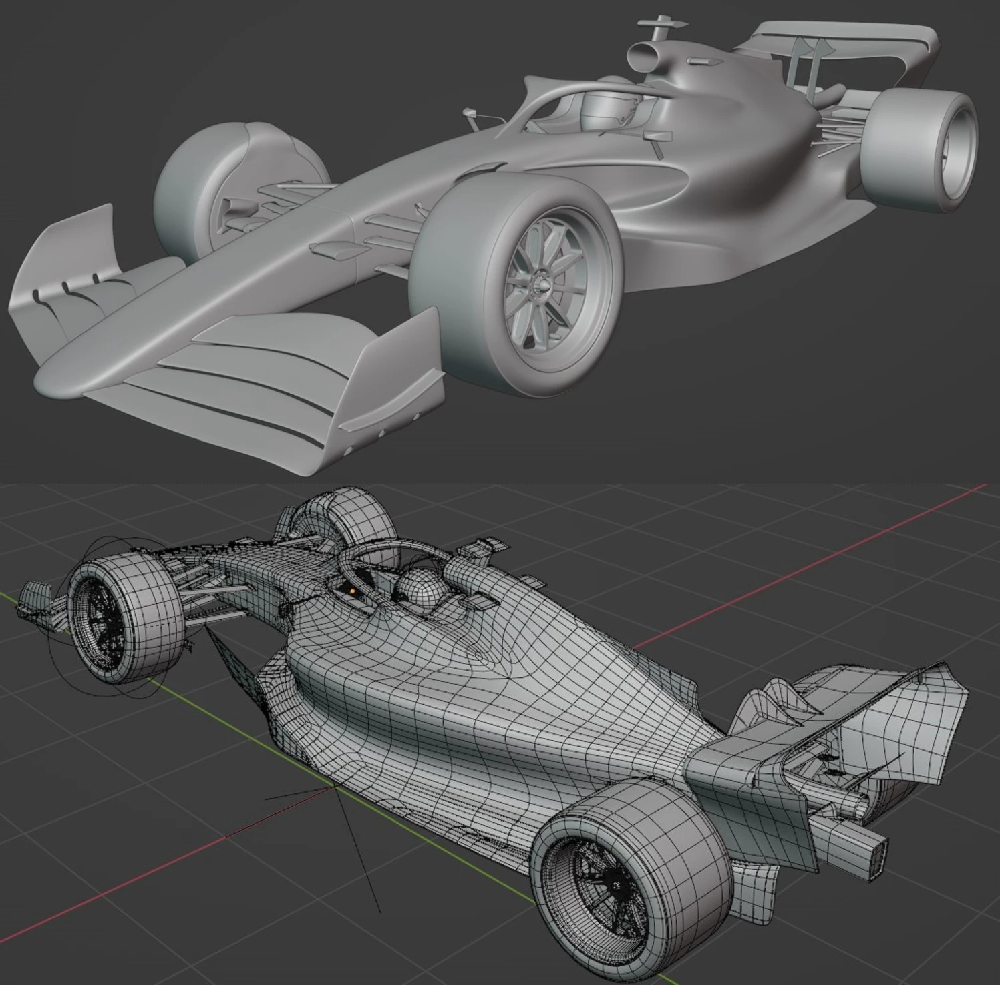
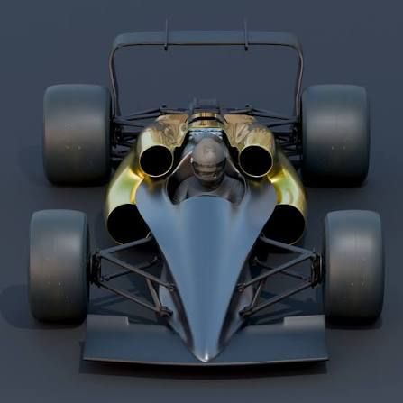
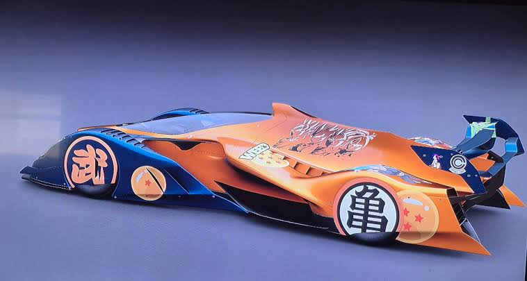
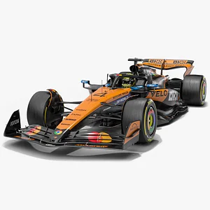
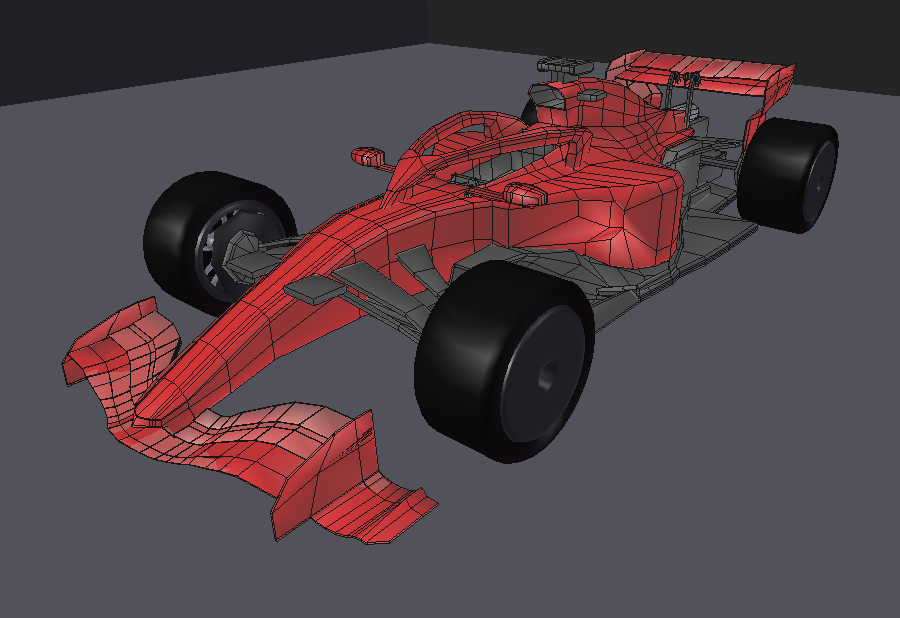
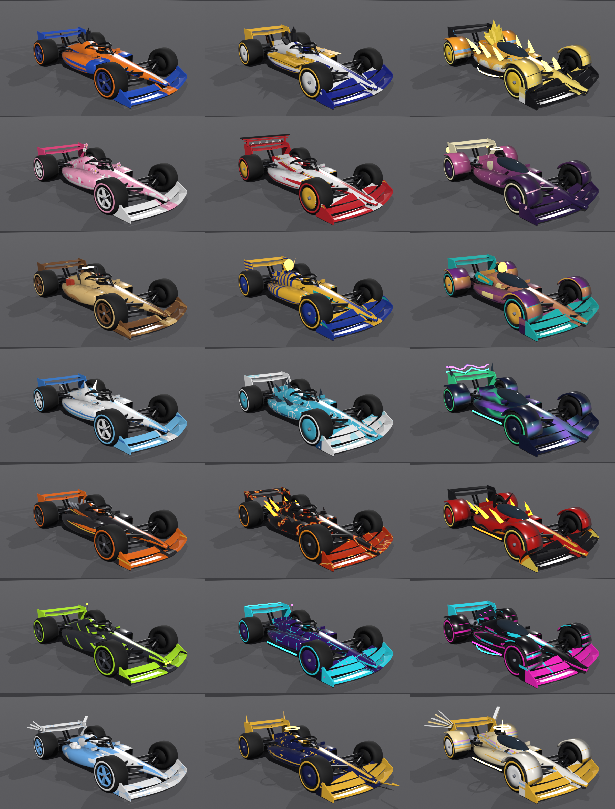
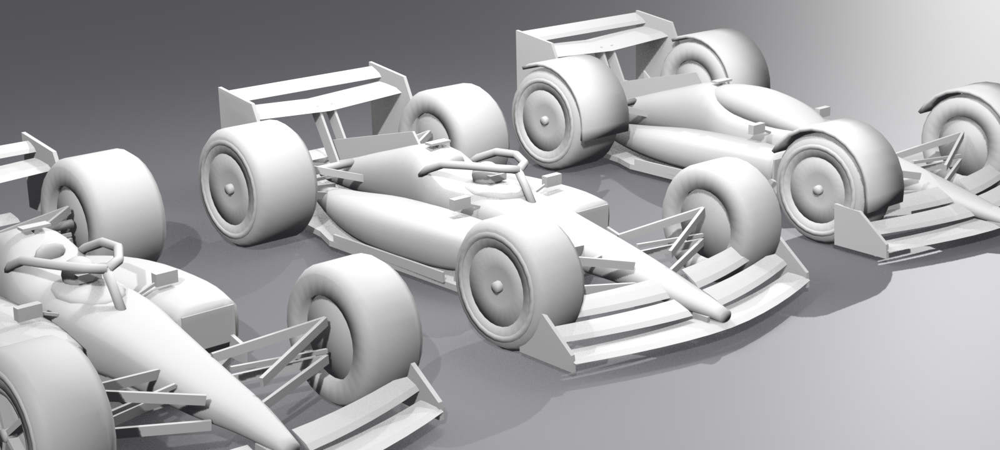

# Referência — carros de Fórmula 1 (15/11/2026)

**Pedido junto com as imagens:** modelar no Blender carros de Fórmula 1 para os carros do jogo; skins com
nexo ao bioma; 3 carros por bioma; os do bioma 1 com as cores do tema e acessórios.

## Imagens do dono

| # | Imagem | O que mostra |
|---|--------|--------------|
| 1 |  | F1 moderno em "clay" (forma pura): asa dianteira de vários elementos, halo, sidepods esculpidos |
| 2 |  | pintura preto/branco/amarelo, calotas nas rodas, faixa colorida no pneu |
| 3 |  | vista lateral: proporção entre-eixos, faixas ao longo do carro |
| 4 |  | o mesmo carro em clay e em malha (fluxo dos loops) |
| 7 |  | vista de cima: turbinas duplas, carroceria dourada |
| 8 |  | protótipo fechado com pintura temática laranja/azul e para-lamas |
| 9 |  | F1 laranja e preto |
| 10 |  | F1 **low-poly** vermelho: o nível de detalhe certo para o Roblox |

**Copiar (estilo):** proporção de fórmula (bico longo, rodas expostas, asas), halo, calotas, faixa colorida no
pneu, pintura em faixas ao longo do carro, para-lamas e turbinas no protótipo.

**Não copiar:** logotipos e marcas das imagens 2, 3 e 9 (federação, fabricante de pneus, patrocinadores,
software), e os kanji, as esferas com estrelas e o logotipo da imagem 8.

## Resultado (versão 1)

Linhas = biomas 1 a 7; colunas = carroceria A (Rookie), B (Pro), C (Hyper).
Forma sem pintura: 

**Antes × agora:** até a Beta 1.9 os carros eram montados com peças do Roblox pelo `CarFactory` (estilo
voxel) e só o 1v1 tinha um corpo "f1" simples. Agora são malhas feitas no Blender, uma por carro.

**Aplicada em:** `arte/` no repositório (ainda não importada no jogo).

Relacionado: [Referências visuais](INDEX.md) · [Carros de F1 no Blender](../05_Modelagem/Carros_F1_Blender.md) · [Beta 2.0](../07_Versoes/Beta_2.0.md) · [Referências antigas](Referencias_Antigas.md)
