# Referência — personagens do bioma 1 (15/11/2026)

**Pedido junto com as imagens:** remodelar o elenco do bioma 1 com base nestas imagens; criar o Mini Goku
(Épico, 2 skins, também voando ao lado do carro), um Secret (Goku Super Saiyajin, com aura) e um Mítico
(Majin Vegeta).

> [!NOTE]
> O dono numerou as imagens contando 21; chegaram 20 arquivos (limite de anexos). A partir da 12ª, o número
> do dono é o número do arquivo **mais um**. A tabela usa as duas numerações.

| Arquivo | Nº do dono | Imagem | Destino no jogo |
|---------|-----------|--------|-----------------|
| 05 | 5 | 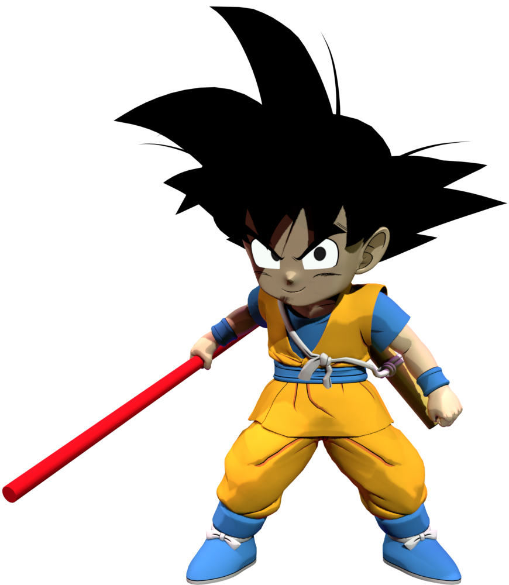 | Mini Gokun, skin clássica (laranja/azul) |
| 06 | 6 | 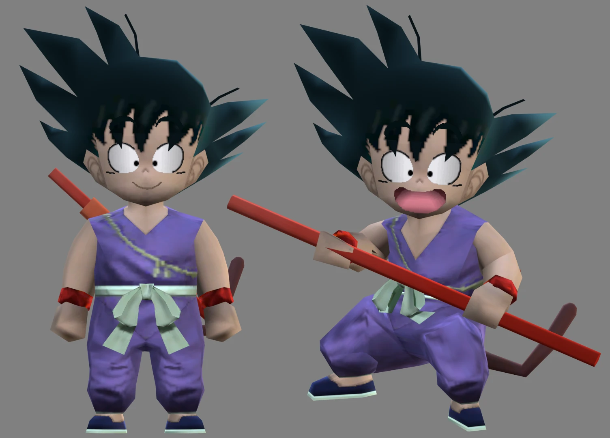 | Mini Gokun, skin roxa; **nível de detalhe alvo (low-poly)** |
| 11 | 12 | 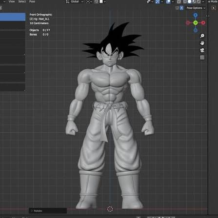 | Gokun (Common) |
| 12 | 13 | 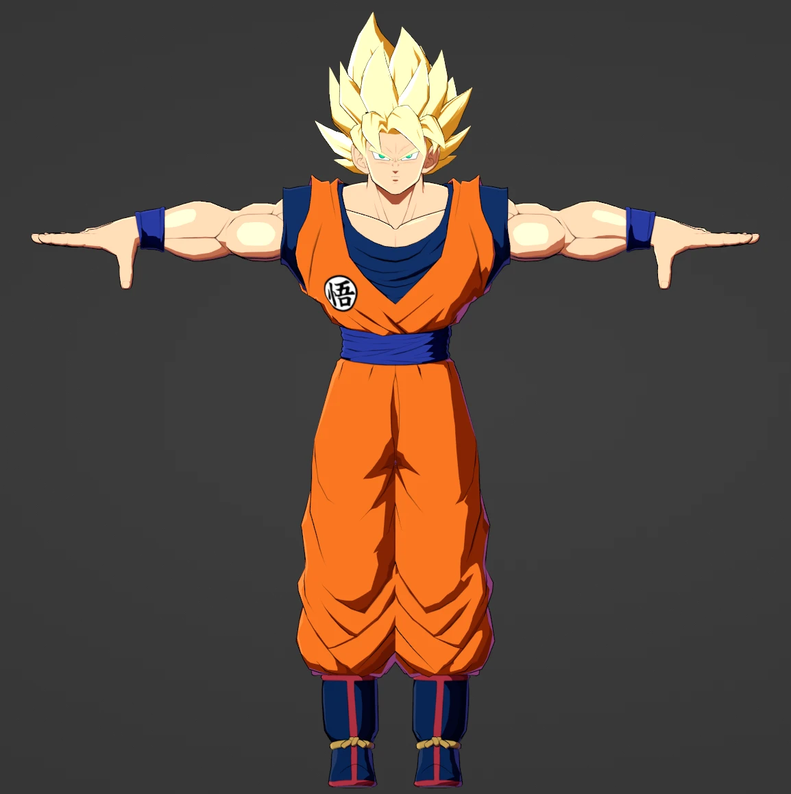 | Super Gokun (Secret, com aura) |
| 13 | 14 | 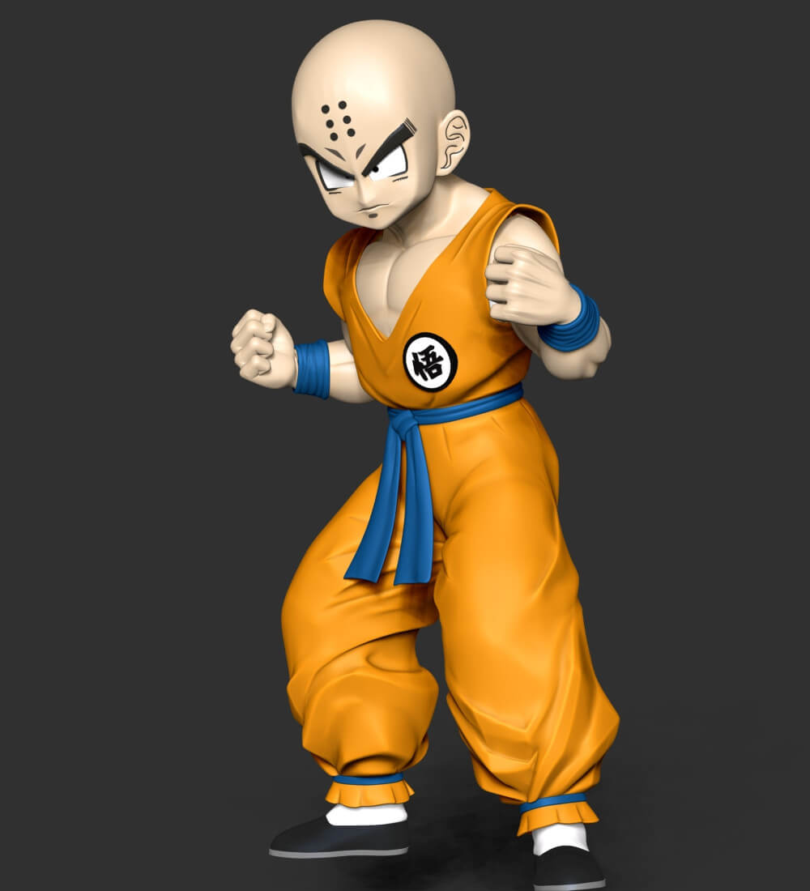 | Kurilin (Common) |
| 14 | 15 | 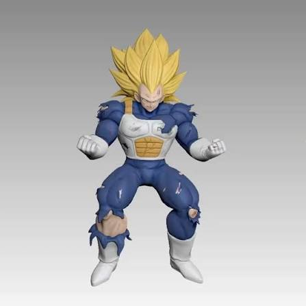 | Majin Vegita (Mythic) |
| 15 | 16 | 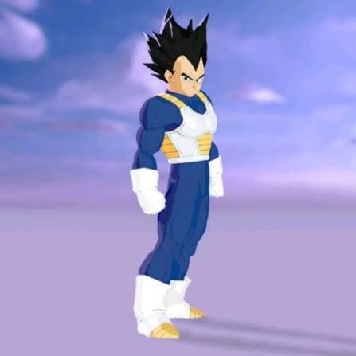 | Vegita (Uncommon) |
| 16 | 17 | 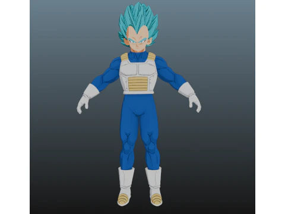 | Majin Vegita (pose e proporção) |
| 17 | 18 | 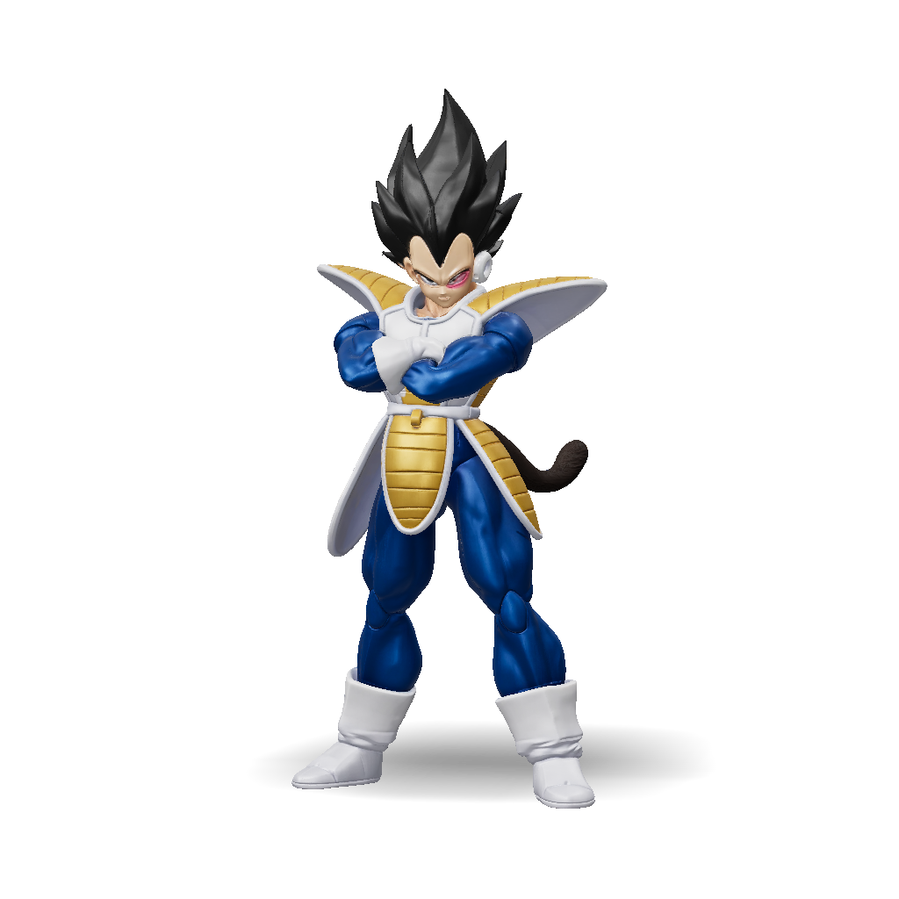 | Vegita (Uncommon), armadura completa |
| 18 | 19 | 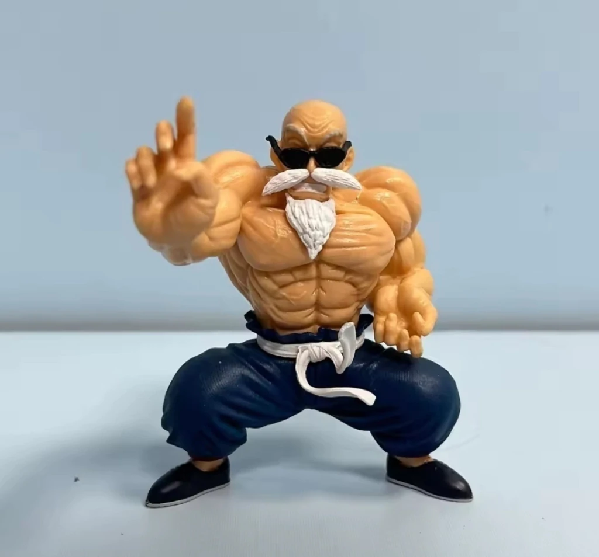 | Master Kamo (Rare) |
| 19 | 20 | 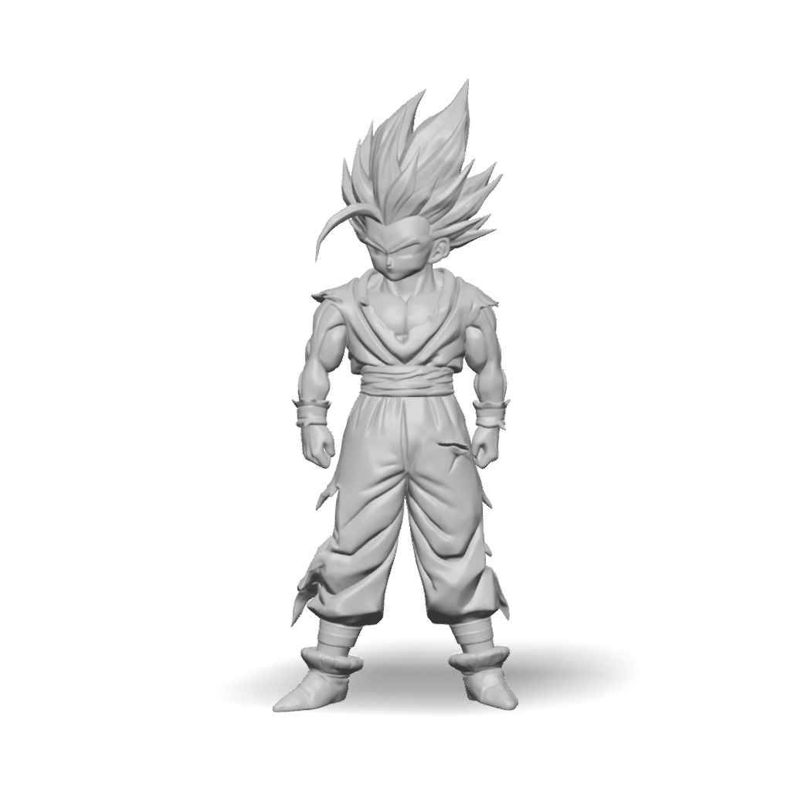 | Gohen (Epic) |
| 20 | 21 | 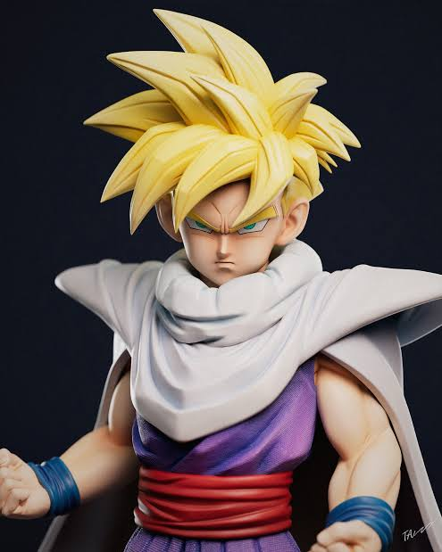 | Gohen (Epic), capa e cores |

**Copiar (estilo):** proporções (chibi no mirim; heroica nos adultos), silhueta do cabelo, paleta das roupas,
pose, a aura no Secret.

**Não copiar:** os emblemas do peito (kanji), o "M" da testa e qualquer marca; não baixar nem importar
modelos 3D de terceiros. Os modelos do jogo são feitos do zero, em low-poly, com os **nomes alterados** que o
jogo já usa (Gokun, Kurilin, Vegita, Master Kamo, Gohen). Ver [Decisões](../08_Pedidos_e_Decisoes/Decisoes.md), linha 6 e linha 27.

## Resultado (estudo, versão 1): Mini Gokun

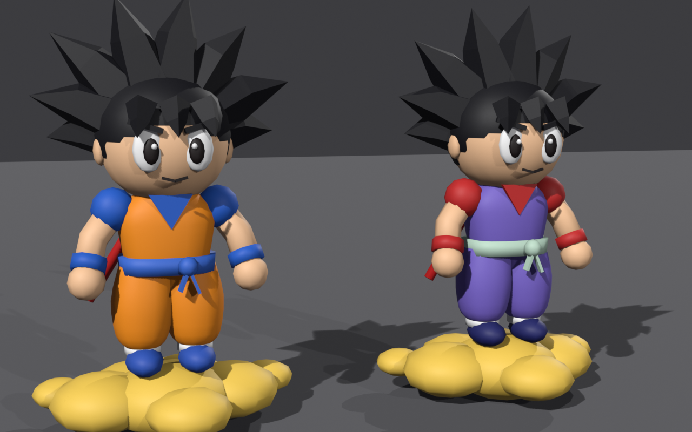

Low-poly próprio (4.168 triângulos), peças separadas para animar por código (cabeça, tronco, braços, pernas,
cauda, bastão, nuvem). Falta: o resto do elenco, a aura, e importar no jogo.

**Antes × agora:** em 10/11 a referência era um avatar R6 em blocos com rosto de anime, e o elenco inteiro
virou "blocos anime" (Beta 1.8b). Agora o pedido é por **malhas modeladas**, mais próximas de figuras 3D.
Os blocos continuam como reserva (o `AnimeModelFactory` cai neles quando não há malha).

Relacionado: [Referências visuais](INDEX.md) · [Personagens](../03_Conteudo/Personagens.md) · [Personagens blocos anime](../05_Modelagem/Personagens_Blocos_Anime.md) · [Beta 2.0](../07_Versoes/Beta_2.0.md)
