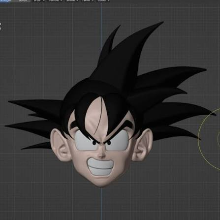
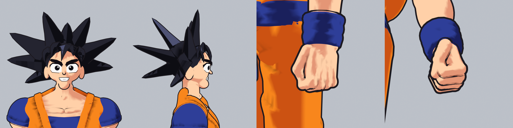
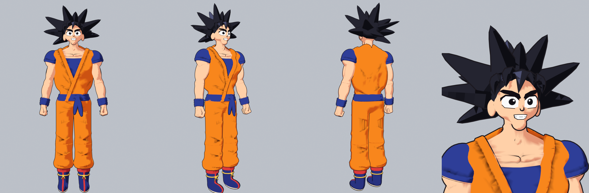
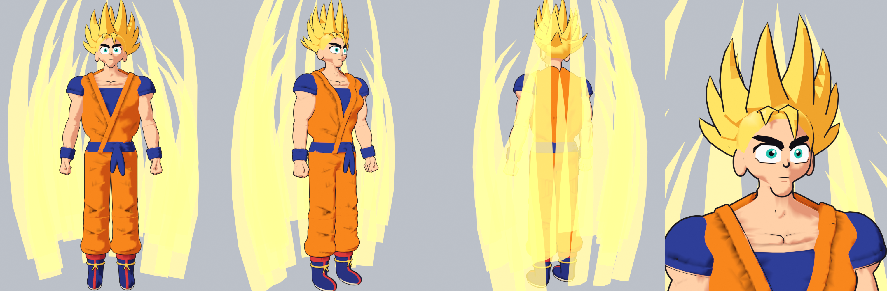
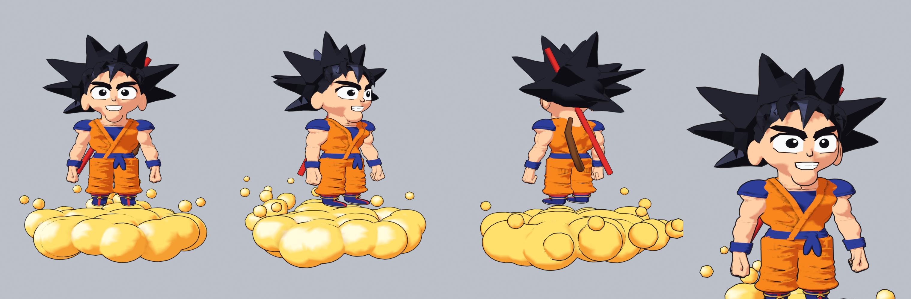
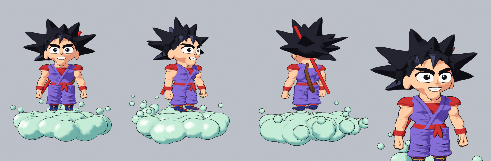
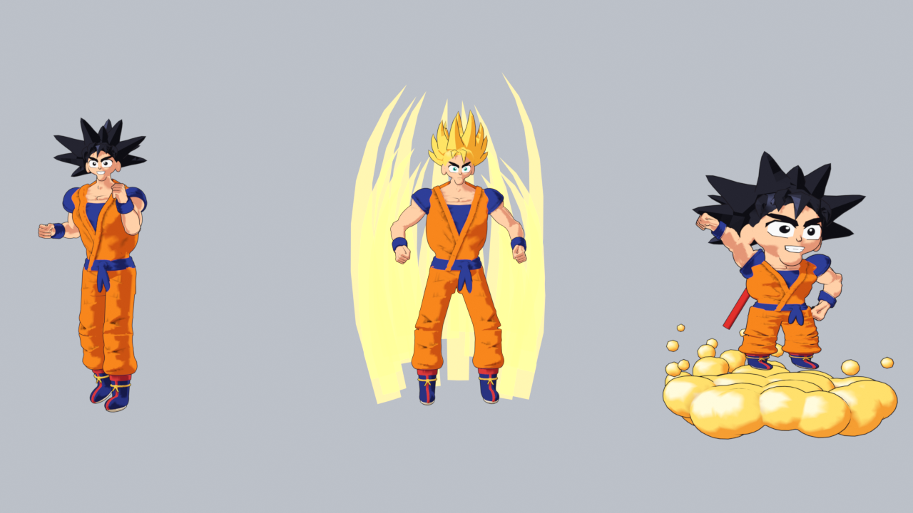
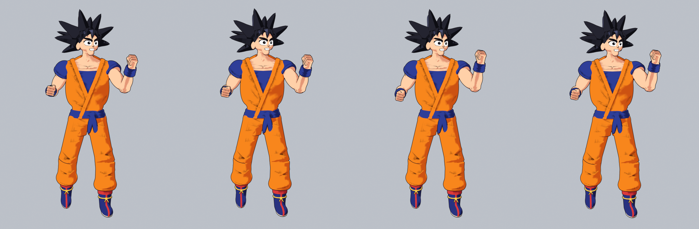
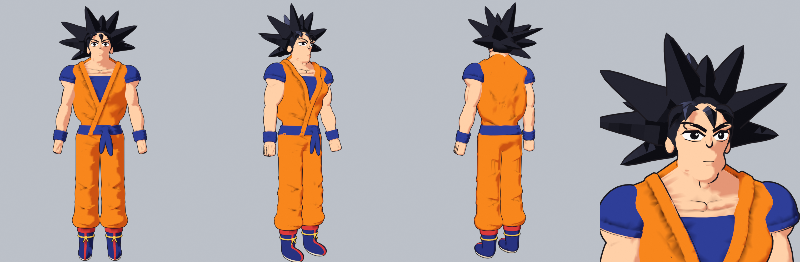

# Referência 16/11/2026 (segundo pedido do dia) — a cabeça

**Pedido do dono:** "Ficou muito maneiro! Só um detalhe: o rosto tá muito colado com o corpo e tá muito queixudo,
deixe ele mais afinado (como de um anime) e o mais próximo da imagem. As mãos estão muito sem sal: dê mais detalhe.
Crie animações para todos (parados, eles ficam se movendo numa pose específica). O resto pode jogar no Studio.
Guarde as versões de modelo que você fez."

**O que tirar da imagem:** crânio grande e redondo; bochecha larga na altura do olho e queixo pequeno; olhos altos e
grandes com pupila preta; sobrancelha grossa em cunha, encostada no olho; sorriso com dentes; nariz mínimo; orelha
grande; franja caindo na testa; mechas em blocos.

## Resultado (v3)

| O quê | Imagem |
|-------|--------|
| Closes: rosto de frente, perfil, mão (costas), mão (dedos) |  |
| Gokun |  |
| Super Gokun (rosto sério) |  |
| Mini Gokun, clássica |  |
| Mini Gokun, violeta |  |
| Animações de parado (um quadro) |  |
| Pose de luta em 4 instantes |  |

Vídeo das três animações: [idle_personagens.mp4](imagens/2026-11-16_resultado_idle_personagens.mp4) (também em `arte/renders/`).

Para comparar com a v2: 

## O que mudou da v2 para a v3

- **Rosto:** saiu a mandíbula quadrada; entrou rosto em V com bochecha, queixo pequeno, órbita rasa e grande.
- **Olhar:** olho quase o dobro da altura, pupila maior, sobrancelha mais grossa e mais baixa (corta o alto do olho).
- **Boca:** sorriso com dentes no Gokun e no Mini; boca fechada e séria no Super.
- **Pescoço:** mais fino e mais comprido, e a cabeça subiu 2,4 cm: o queixo não encosta mais no peito.
- **Cabelo:** o couro cabeludo desce até a linha da testa e a franja agora é feita de mechas por fora do crânio.
- **Mãos:** quatro dedos dobrados com nó, polegar por cima, tendões nas costas da mão e o osso do pulso.
- **Articulações:** braço e perna viraram duas peças cada (cotovelo e joelho), para as poses.

Como é feito: [Personagens por SDF](../05_Modelagem/Personagens_SDF_Blender.md) · animação: [Animação de parado](../05_Modelagem/Animacao_Idle_CharacterRig.md).

Relacionado: [Referências 16/11 (v2)](2026-11-16_Gokun_Referencias_v2.md) · [Beta 2.0](../07_Versoes/Beta_2.0.md) · [Decisões](../08_Pedidos_e_Decisoes/Decisoes.md)

Up: [Referências visuais](INDEX.md)
