# Referências 16/11/2026 — o estilo que o dono quer nos personagens

**Pedido do dono (16/11):** os carros estão aprovados. O Mini Gokun v1 "está ficando bom", mas falta
detalhamento de músculos, sombreamento e textura, o rosto tem de ser mais másculo e a nuvem não pode ser
"só uma cor amarela". Guardar os modelos antigos e **mudar o estilo** para o das imagens abaixo: anime 2.5D
com cel-shading (dois tons, linhas de tinta, cabelo em mechas afiadas, dobras de tecido marcadas).

## O que cada imagem ensina

| # | Imagem | O que tirar dela |
|---|--------|------------------|
| 1 | 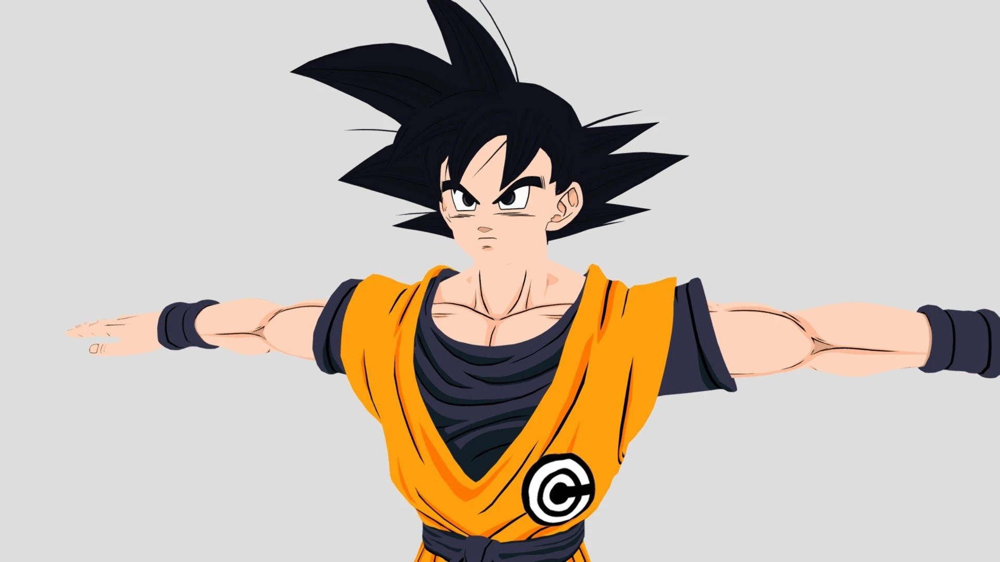 | cel-shading com linha de tinta; sombra em bloco no tecido; músculo com linhas finas |
| 2 | 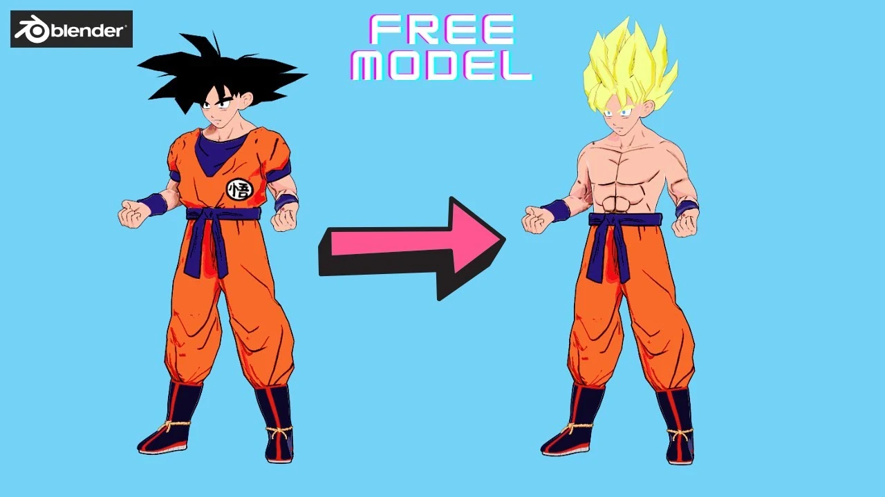 | corpo inteiro, base e forma dourada sem camisa; calça larga com dobras; botas |
| 3 | 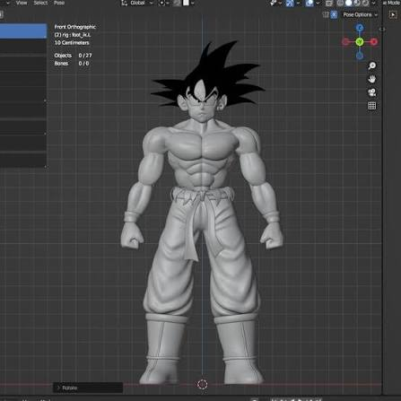 | escultura em cinza: volume dos músculos, calça e botas (o "clay" por baixo do toon) |
| 4 | 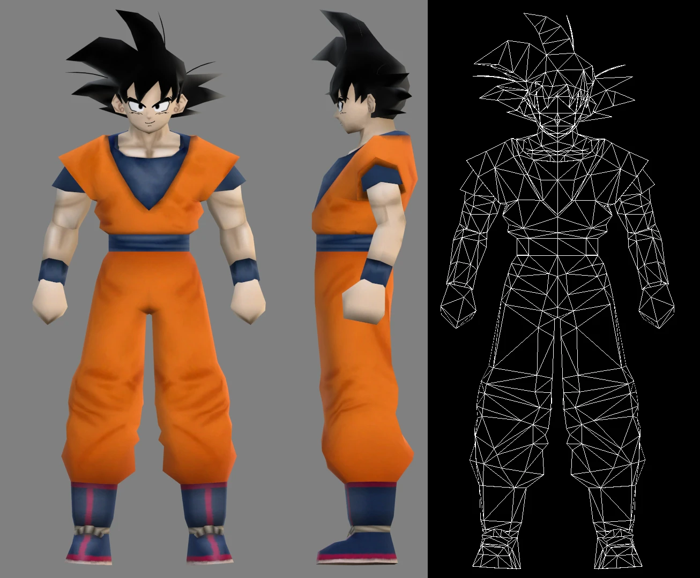 | versão de poucos polígonos com malha à mostra: prova de que a silhueta se resolve com pouco |
| 5 | 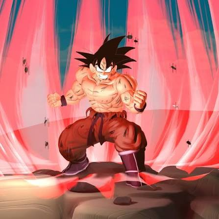 | pose de força com aura; sombra dura no torso |
| 6 | 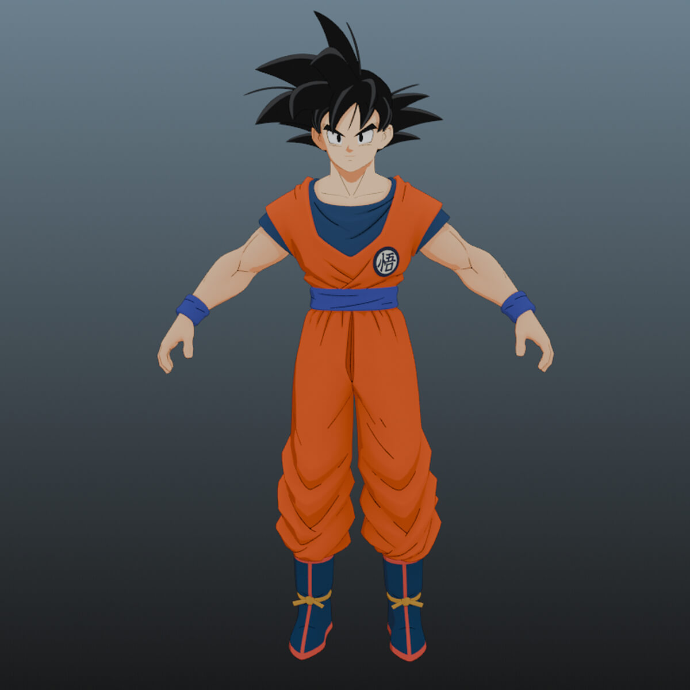 | pose em A limpa, sombra suave em dois tons, proporção de 7 cabeças |
| 7 | 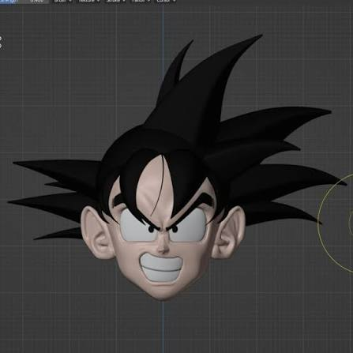 | cabeça: mechas em blocos, mandíbula marcada, expressão |
| 8 | 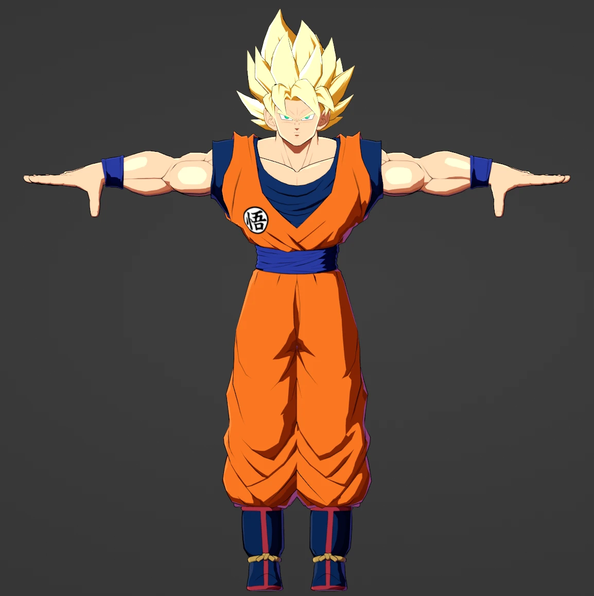 | forma dourada em T: cabelo todo para cima, olho verde-água, sombra chapada |
| 9 | 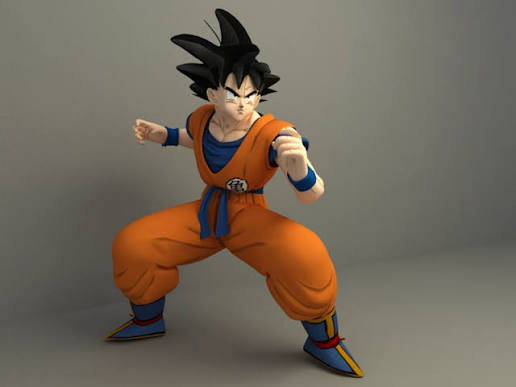 | pose de luta, cores saturadas |

## Resultado (v2, 16/11)

| Personagem | Folha (frente, 3/4, costas, rosto) |
|------------|-------------------------------------|
| Gokun (Common) | 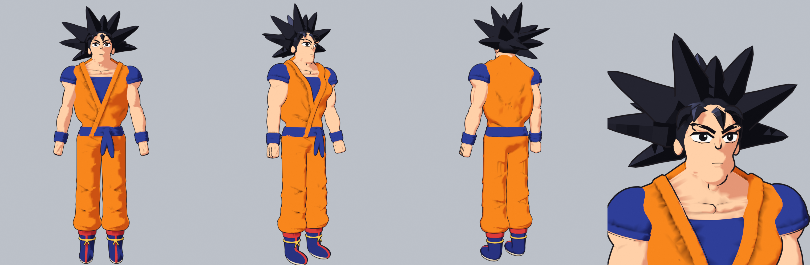 |
| Super Gokun (Secret, com aura) | 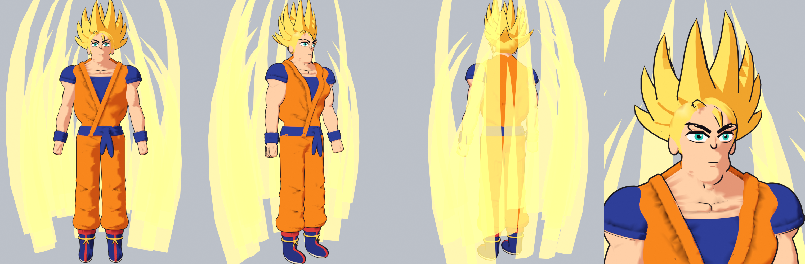 |
| Mini Gokun, skin clássica (Épico) | 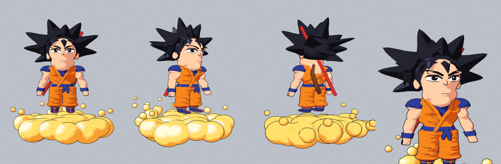 |
| Mini Gokun, skin violeta | 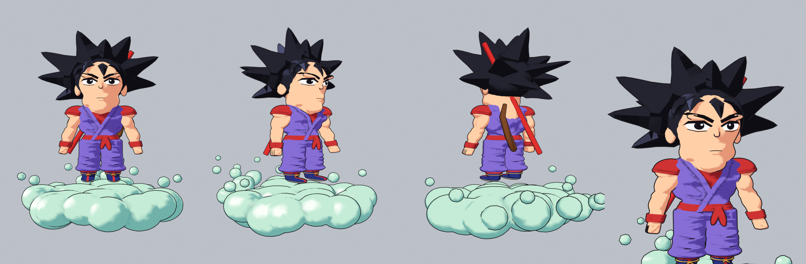 |

Para comparar com a v1 (blocos): 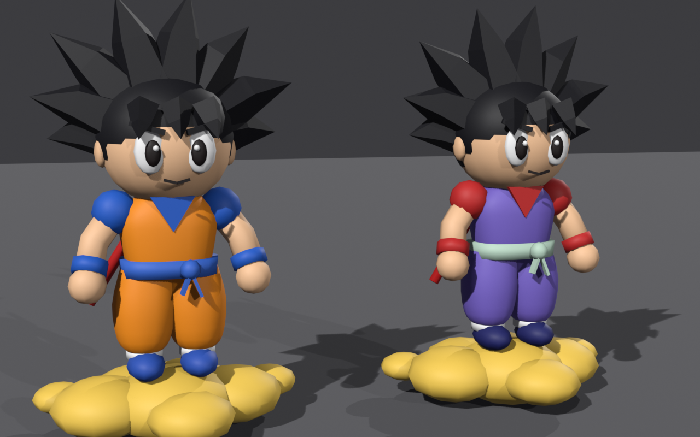

## O que mudou da v1 para a v2

- **Técnica:** de esferas e tubos para escultura por campos de distância → [Personagens por SDF](../05_Modelagem/Personagens_SDF_Blender.md).
- **Músculos:** deltoide, bíceps, tríceps, antebraço, peitoral, trapézio, clavícula e pescoço fundidos com vinco.
- **Roupa:** gola em V com lapela cruzada, ombreira, faixa com nó e pontas, dobras esculpidas, munhequeiras, botas com cordão.
- **Rosto:** mandíbula quadrada, sobrancelha grossa, olho anguloso; desenhado em polígonos sobre a pele.
- **Sombra:** dois tons pintados nos vértices, sombra projetada (cabelo na testa, queixo no pescoço) e linhas nos vincos.
- **Nuvem:** gomos com vinco, brilho no topo, sombra laranja por baixo e rastro de bolhas de fumaça.

## O que NÃO foi copiado (decisão 27)

Os emblemas (kanji, o símbolo da cápsula) e o desenho exato de cada imagem. São modelos próprios, com os nomes
alterados do jogo, feitos do zero por script. Nada foi baixado da web.

Relacionado: [Personagens do bioma 1 (15/11)](2026-11-15_Beta2_Personagens_Bioma1.md) · [Beta 2.0](../07_Versoes/Beta_2.0.md) · [Decisões](../08_Pedidos_e_Decisoes/Decisoes.md)

Up: [Referências visuais](INDEX.md)
