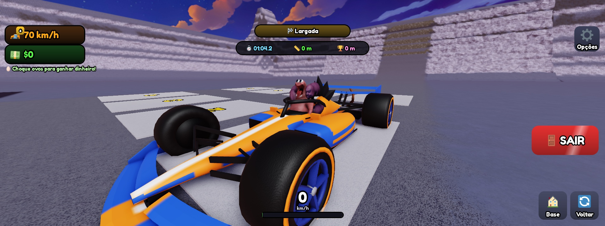
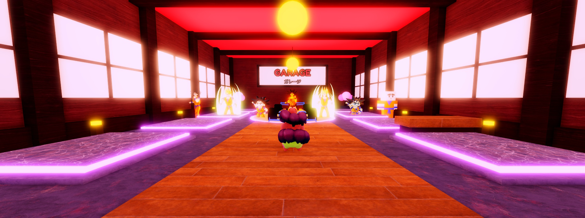

# Sessão 22/11/2026 (2) — Beta 2.0 aplicada ao jogo

**Pedido:** "Sim! Pode fazer e APLICAR AO JOGO!" — trocar os carros e personagens antigos pelos novos: corrida com os
carros novos, garagem e vitrine com os personagens animados.

## O que foi feito

- `CarFactory`: carroceria de malha para os 12 carros da Config (7 da corrida solo + 5 F1 do 1v1). Física igual.
- `AnimeModelFactory`: Gokun em malha; **novos** Super Gokun (Secret) e Mini Gokun (Epic) no bioma 1.
- `Client.CharacterAnimator` (novo): anima no cliente os personagens de malha; nos ícones, só a pose.
- `Config.Version = "Beta 2.0"`, novidades no menu, tudo atrás de `Config.Features.MeshArt`.
- Place salvo (versão 132), não publicado. Espelho em `src/`, tag `beta-2.0`.

## Resultado

## Testado / não testado

- **Testado (Play):** menu "Beta 2.0"; corrida com o carro novo (69/70 km/h, rodas girando e esterçando, jogador sentado no
  cockpit); carro na garagem; personagens montados pelo servidor e animados no cliente (com streaming); Output sem erros.
- **Não testado:** chocar os novos no ovo, ícones do inventário e roleta, batalha, 1v1 com 2 jogadores, celular.

## Lições

Em [Pegadinhas técnicas](../09_Erros_e_Licoes/Pegadinhas_Tecnicas.md): cliques do MCP não chegam ao menu inicial (use o
`Shared.Net` do cliente); `require` no execute_luau roda numa cópia dos módulos; respostas acima de ~100 mil caracteres
são cortadas; streaming entrega a malha em pedaços.

## Próximo passo

Dono: jogar e dizer o que achou; publicar; baixar o `.rbxl`. Claude: 2.0b (combustível, teto do motor, Fuel Engine).

Relacionado: [Sessão anterior (importação)](2026-11-22_Beta_2.0_Malhas_no_Roblox.md) · [Beta 2.0](../07_Versoes/Beta_2.0.md)

Up: [Registro de sessões](INDEX.md)
