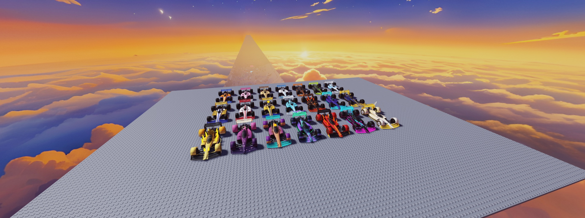
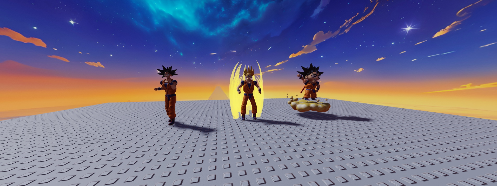
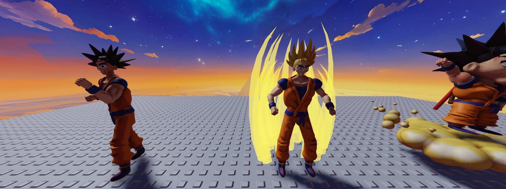

# Sessão 22/11/2026 — malhas no Roblox

**Pedido:** "Tente novamente" (o dono tinha aprovado a pasta de upload).

## O que foi feito

- **Upload liberado:** a pasta `arte\export` agora está aprovada. Primeiro um carro de teste (`warrior_a`), conferido
  no Studio; depois os outros 20 carros e os 4 personagens de jogo. **25 assets**, todos aprovados pela moderação, no
  grupo 879120012. IDs em `arte/export/assets_roblox.json`.
- **No place:** `ReplicatedStorage.Assets` com `Cars/<21 ids>` e `Characters/<4 ids>`, normalizados: frente em -Z,
  `Root` no chão (carros: meio das 4 rodas; personagens: pés), ancorados, sem PackageLink, atributos `AssetId`,
  `DisplayName`, `AnimId` (personagens). Entrada "parte 2" no `01_ChangeLog`. Place salvo (versão 129), não publicado.
- **Commit anterior** (personagens v3 + CharacterRig, de 16/11) enfim entrou no `main`.

## Resultado no Roblox

| | |
|---|---|
| 21 carros |  |
| personagens animados |  |
| de perto |  |

## Testado / não testado

- **Testado (modo Edit):** os 21 carros com pintura, cores por vértice e rodas; os 3 personagens animados pelo
  `CharacterRig` com as malhas reais (poses e pés no chão iguais ao Blender).
- **Não testado:** Play, celular, física dos carros novos (ainda não ligados ao `CarFactory`), desempenho.

## Lições

Em [Pegadinhas técnicas](../09_Erros_e_Licoes/Pegadinhas_Tecnicas.md): o importador gira cada modelo num ângulo
qualquer; a cor por vértice do FBX funciona no MeshPart; a malha demora a aparecer na primeira captura; o `git merge`
também precisa da identidade.

## Próximo passo

Etapa B de verdade: `CarFactory` montando o carro do jogo com a malha (`Assets.Cars`), garagem e vitrine mostrando os
personagens novos com o `CharacterRig`, teste no Play. Depois a Etapa C (combustível, piloto automático, primeira pessoa).

Relacionado: [Sessão 16/11 (2)](2026-11-16_Beta_2.0_Personagens_v3_e_Rig.md) · [Beta 2.0](../07_Versoes/Beta_2.0.md)

Up: [Registro de sessões](INDEX.md)
