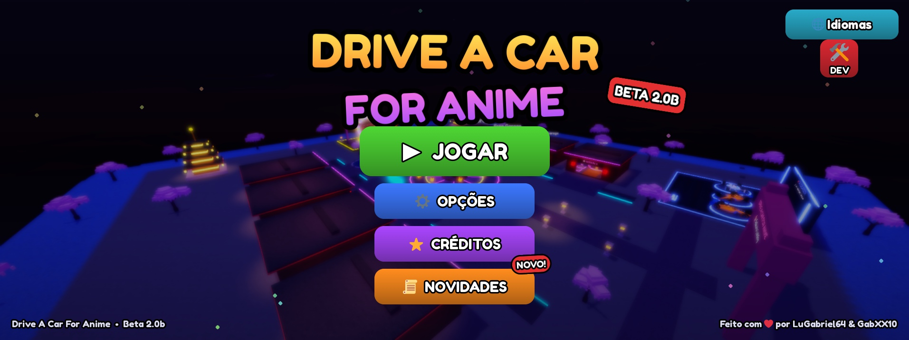
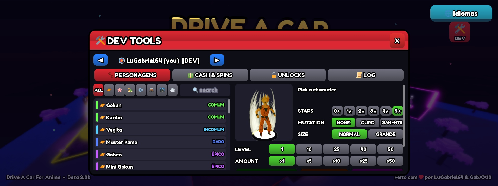

# Sessão 25/11/2026 — Beta 2.0b: painel DEV e créditos

**Pedido:** "FICOU MUITO BOM! ESTÁ ÓTIMO! Só precisamos mexer no design dos outros personagens e podemos partir para uma
nova missão. Agora: uma aba só nossa (cargo DEV) para pegar personagens sem correr, com quantas estrelas quiser, dinheiro
e spins. Faça algo realmente para DEVS. E mude os créditos para LuGabriel64 e Gabxx10."

## O que aconteceu

1. O Studio estava num **Play com os dois devs** (LuGabriel64 e GabXX10 no lobby). Uma tentativa de parar o Play foi feita
   antes de perceber; o Play **não** parou. O código foi escrito enquanto isso e aplicado depois do "pode aplicar".
2. IDs pelo Roblox: LuGabriel64 = 158350958, GabXX10 = 338868517. Grupo "Resenha's House": os dois são Admin (254), sem cargo DEV.
3. Backup `Backups["Beta 2.0"]`; `Services.DevService` e `Client.DevPanel` novos; `Config` (versão, créditos, `Config.Dev`).
4. Play: 10 ações testadas pelo Net, telas capturadas, Output limpo. Place salvo (versão 135). Espelho, docs e tag `beta-2.0b`.

## Resultado

Detalhes: [Painel DEV](../02_Sistemas/Painel_DEV.md) · [Beta 2.0b](../07_Versoes/Beta_2.0b.md)

## Lições

Em [Pegadinhas técnicas](../09_Erros_e_Licoes/Pegadinhas_Tecnicas.md): o Studio pode estar num Play com outra pessoa
(Team Test); `Source` não é legível no datamodel Client; string longa `[[ ]]` dentro de outra quebra o execute_luau.

## Próximo passo

Dono: testar o painel com cliques de verdade e com o GabXX10 (dar coisas um ao outro); publicar. Depois: design dos outros
personagens e a "nova missão" (2.0c combustível, se o dono quiser).

Up: [Registro de sessões](INDEX.md)
